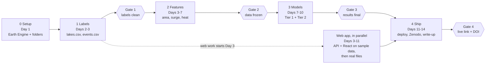

# KaraGLOF — Product Requirements Document

**Version:** 1.0 · **Date:** 2026-10-19 · **Companion:** [SPECS.md](SPECS.md) (technical specification)

---

## 1. Overview

KaraGLOF is a web application. Each year it ranks glacial lakes in the Karakoram by how susceptible they are to an outburst flood, and each week it flags warning signs at three high-risk ice-dammed lakes. It is built from free satellite data, a LightGBM model and a FastAPI + React map. The aim is to finish as fast as possible rather than on a fixed 12-week calendar.

**Problem.** Glacial Lake Outburst Floods (GLOFs) in Gilgit-Baltistan destroy bridges, the Karakoram Highway and villages. The May 2022 Shisper outburst took out the Hassanabad bridge. Monitoring today is sparse, and no open tool combines lake growth, glacier surges and heat in one view.

**Why the Karakoram is different.** In most of the Himalaya, GLOFs come from moraine-dammed lakes that grow slowly over decades. In the Karakoram, many dangerous lakes are ice-dammed. A surging glacier advances across a valley, blocks the river, and the lake behind it then drains suddenly. Shisper and Khurdopin are textbook cases. Generic models trained on global inventories miss this mechanism, and that is the project's research gap.

**What it is.** An open, reproducible research prototype: a dataset, two models, and a public web app that explains every risk score.

**What it is not.** It is not an official warning system and does not issue evacuation alerts. Every page says "Research prototype — decision support only".

**Research question.** Do glacier-surge signals plus lake growth from all-weather radar improve GLOF susceptibility ranking? Do they give days-to-weeks of lead time for ice-dammed lakes in the Karakoram?

---

## 2. Goals, non-goals and success metrics

The project succeeds when a professor can open one live link and do three things: see a ranked map of lakes, understand why a lake is risky, and watch the Shisper 2022 replay flag the outburst before it happened.

### Goals

1. **Product:** a deployed web app with a lake map, a yearly risk ranking, per-lake explanations and a Tier 2 replay.
2. **Research:** a susceptibility model with no data leakage, plus an ablation that tests whether surge features help.
3. **Data:** an open Karakoram lake-year dataset on Zenodo with a DOI.
4. **Career:** a clean public GitHub history in milestones, a short write-up and a demo for MS GRA emails.

### Non-goals

- Official alerts, SMS warnings or evacuation advice.
- Modelling where the flood water goes downstream (flood routing or inundation).
- Live Earth Engine calls from the server (results are precomputed).
- User accounts, admin panels or a mobile app.
- Regions outside the Hunza, Shimshal and Shigar basins.

### Success metrics

| Area | Metric | Target |
| --- | --- | --- |
| Tier 1 model | PR-AUC on 2020–2025 test years | Higher than the logistic baseline and the no-skill rate (the share of positives) |
| Tier 1 model | Recall at top-10 lakes per year | At least half of test-year events fall in that year's top 10 |
| Tier 1 model | Calibration (Brier score) | Lower than the baseline |
| Ablation | PR-AUC with vs without surge features | Reported with a bootstrap 95% confidence interval, whatever the result |
| Tier 2 | Lead time on Shisper 2022 | Amber or red raised at least 7 days before drainage |
| Tier 2 | False alarms | Counted per lake per melt season and reported |
| Web app | Page load | Under 3 seconds on a normal connection |
| Delivery | Live link + repo + Zenodo DOI | All three public at the end |

The targets are honest goals, not promises. With few events, a negative ablation result is still a valid finding and is reported.

---

## 3. Users and use cases

The primary user is a professor or recruiter judging the work in under five minutes. The app is built for that visit first.

| Persona | Need | What they do in the app |
| --- | --- | --- |
| Professor / recruiter (primary) | Judge rigour and engineering quickly | Opens the map, reads the Method page, watches the Shisper replay, opens GitHub |
| Disaster-risk analyst (secondary) | Know which lakes to watch this season | Reads the ranking, filters by basin, checks why a lake is high |
| Researcher (secondary) | Reuse the data | Downloads the dataset and reads the data dictionary |

### Use cases

1. **UC1 — See this year's riskiest lakes.** Open the home page → the map shows lakes coloured by risk score → a side panel lists the top 10 → choose a year from 2020 to 2025.
2. **UC2 — Understand one lake.** Click a lake → the lake page shows its area history since 2000, its risk score by year, and the top SHAP drivers in plain words (for example "lake area grew 40% in 3 years").
3. **UC3 — Replay a real outburst.** Open the Shisper 2022 case → weekly lake area and temperature charts with the alert level for each week → a marker shows the drainage date and the lead time.
4. **UC4 — Check the method.** Open the Method page → data sources, time split, metrics table, ablation result and limitations.
5. **UC5 — Get the data.** Open the Data page → download CSV files and follow the Zenodo DOI link.

Every page shows the disclaimer banner and links to the repository.

---

## 4. Scope

The scope is every mapped glacial lake in the Hunza, Shimshal and Shigar basins for 2000–2025, with three ice-dammed lakes watched weekly.

- **Area:** the Hunza, Shimshal and Shigar river basins, Gilgit-Baltistan, Pakistan. Basin outlines come from HydroBASINS (level 7 or 8).
- **Period:** 2000–2025 for yearly data; 2015–2025 for weekly radar data (Sentinel-1 coverage).
- **Tier 1 lakes:** every lake in the lake inventory inside the three basins that is larger than 0.01 km² (about 10,000 m², roughly 10 Landsat pixels). The count should be in the low hundreds; notebook 01 fixes the exact number.
- **Tier 2 lakes:** Shisper (Hassanabad Nala), Khurdopin (Shimshal river) and Passu, chosen because each has a documented outburst history.

| Site in the original MODIS zip | Decision | Reason |
| --- | --- | --- |
| Shisper | Keep, Tier 2 | Surge-dammed lake; outbursts in 2019, 2020 and 2022 |
| Khurdopin | Keep, Tier 2 | Surging glacier repeatedly dams the Shimshal river |
| Passu | Keep, Tier 2 | Documented GLOF history near Passu village |
| Hispar | Tier 1 only, if a defined lake exists | A glacier, not a specific lake |
| Minapin | Tier 1 only, if a defined lake exists | No prominent GLOF lake |
| Attabad | Exclude (optional non-GLOF control) | Landslide-dammed lake from 2010, not glacial |
| Gayari | Exclude | 2012 avalanche site, not a lake |

> **Open question:** the exact Shisper 2022 drainage date and the Khurdopin event dates will be confirmed from the inventories in notebook 01, not from memory.

---

## 5. Functional requirements

There are 25 requirements in five groups. "Must" items ship in the first public version; "should" items ship if time allows.

| ID | Requirement | Priority |
| --- | --- | --- |
| **Data pipeline** | | |
| FR-1 | Build `lakes.csv`: one row per lake with ID, name, basin, centroid, area, dam type and parent glacier ID | Must |
| FR-2 | Build `events.csv`: one row per GLOF event with lake ID, date, date certainty and source | Must |
| FR-3 | Compute the largest summer lake area each year, 2000–2025, from Landsat 5/7/8/9 and Sentinel-2 | Must |
| FR-4 | Compute weekly lake area 2015–2025 from Sentinel-1 radar for the three Tier 2 lakes | Must |
| FR-5 | Extract yearly glacier velocity for each parent glacier from ITS_LIVE and flag surge years | Must |
| FR-6 | Extract climate features from ERA5-Land (degree-days, heat anomalies, rainfall) and the MODIS zip | Must |
| FR-7 | Extract terrain features from the Copernicus GLO-30 DEM | Must |
| FR-8 | Join all features into `lake_year.parquet` and `lake_week.parquet`, using only data from before each prediction time | Must |
| **Tier 1 model** | | |
| FR-9 | Train logistic regression, Random Forest and LightGBM on the time split | Must |
| FR-10 | Report PR-AUC, recall at top-10, Brier score and bootstrap confidence intervals | Must |
| FR-11 | Produce SHAP values per lake-year and a global importance plot | Must |
| FR-12 | Run the ablation with and without surge features | Must |
| FR-13 | Export `ranking.csv` (risk score per lake per year) and `shap_top.csv` (top 5 drivers per lake-year) | Must |
| **Tier 2 watch** | | |
| FR-14 | Apply weekly rules (lake growth + heat) to set green, amber or red per lake-week | Must |
| FR-15 | Measure lead time and false alarms on known events; export `alerts.csv` | Must |
| **API** | | |
| FR-16 | Serve lakes, rankings, lake detail, alerts and metrics as JSON (see SPECS §5) | Must |
| FR-17 | Serve lakes as GeoJSON for the map | Must |
| FR-18 | Serve dataset downloads as CSV | Should |
| **Web app** | | |
| FR-19 | Map of lakes coloured by risk, with a year selector and basin filter | Must |
| FR-20 | Top-10 ranking panel linked to the map | Must |
| FR-21 | Lake detail page: area history, risk by year, SHAP drivers in plain words | Must |
| FR-22 | Case-study page replaying Shisper 2022 week by week | Must |
| FR-23 | Method page with metrics, ablation and limitations | Must |
| FR-24 | Data page with downloads and the Zenodo DOI | Should |
| FR-25 | Disclaimer banner on every page | Must |

---

## 6. Non-functional requirements

The bar: anyone can rerun the pipeline, the app is free to host and fast to open, and it never overstates what it predicts.

| ID | Area | Requirement |
| --- | --- | --- |
| NFR-1 | Reproducibility | Every notebook runs top to bottom on a fresh Colab session; random seeds are fixed (42); package versions are pinned in `requirements.txt` |
| NFR-2 | Reproducibility | Each data release has a version tag (`data-v1`), stored in `metrics.json` and shown in the app |
| NFR-3 | Leakage | An automated test fails if any Tier 1 feature uses data from the prediction year or later |
| NFR-4 | Performance | API responses under 300 ms once warm; web page usable in under 3 s |
| NFR-5 | Cost | Zero running cost: free tiers only, no paid APIs |
| NFR-6 | Accessibility | Colour-blind-safe scales; text labels beside every colour; controls usable by keyboard |
| NFR-7 | Security | Read-only API, no user data, no secrets in the repo (Earth Engine credentials stay in Colab) |
| NFR-8 | Ethics | Disclaimer banner on every page; the wording says "susceptibility" and "warning signs", never "predicts floods" |
| NFR-9 | Licensing | Code under MIT; derived data under CC BY 4.0; every source credited on the Data page |
| NFR-10 | Code quality | Lint and tests pass in CI on every push |

---

## 7. Milestones and commit plan

The target is about 14 working days. The pace depends on how fast the Earth Engine exports run and how quickly results come back. Each phase ends at a gate that must pass before the next phase starts.

| Phase | Days | Gate at the end | Gate criterion |
| --- | --- | --- | --- |
| 0 Setup | 1 | — | Earth Engine works in Colab; folders ready |
| 1 Labels | 2–3 | Labels clean | Every event has a lake_id and date certainty, or is listed as unmatched |
| 2 Features | 3–7 | Data frozen | No new features after this |
| 3 Models | 7–10 | Results final | Test set scored once; Tier 2 thresholds frozen before the 2022 replay |
| Web app (parallel) | 3–11 | — | Built on sample data in the exact output format, then switched to real files |
| 4 Ship | 11–14 | Live link | Live link and DOI public |

### Commit plan

Claude writes files and never commits or pushes. You review, commit and push each milestone to [github.com/inamjadoon/KaraGlof](https://github.com/inamjadoon/KaraGlof). Commit small pieces daily to keep your streak; each line below is one milestone, tagged when it lands.

- [ ] `v0.1` — `chore: project scaffold, README, licence, PRD and specs`
- [ ] `v0.2` — `data: notebook 01, lakes and events tables`
- [ ] `v0.3` — `data: notebook 02, yearly and weekly lake area`
- [ ] `v0.4` — `data: notebook 03, features and dataset v1 frozen`
- [ ] `v0.5` — `api: FastAPI service with sample data and tests`
- [ ] `v0.6` — `web: React map, ranking and lake pages`
- [ ] `v0.7` — `model: notebook 04, Tier 1 results, SHAP and ablation`
- [ ] `v0.8` — `model: notebook 05, Tier 2 rules and Shisper replay`
- [ ] `v0.9` — `web: case replay, method and data pages on real data`
- [ ] `v1.0` — `ops: Docker, CI, deploy; docs: write-up, Zenodo DOI, slides`

---

## 8. Risks, limitations and future work

The biggest risk is having too few labelled events in the study area. The plan answers it with event-level reporting, confidence intervals and case studies instead of a headline accuracy number.

| Risk | Likelihood | Impact | Mitigation |
| --- | --- | --- | --- |
| Too few events (perhaps 20–50 in the three basins) | High | Wide CIs, unstable model | Report CIs and event-level ranks; leave-one-year-out check; lean on the Tier 2 case studies |
| Event dates uncertain or lakes hard to match | Medium | Wrong labels | `date_certainty` column; unmatched list; cross-check two inventories |
| Clouds and shadows in optical images | High | Gaps in lake area | Summer maximum composite; Sentinel-1 radar for Tier 2; flag filled years |
| Sentinel-1 lake mapping noisy in steep valleys | Medium | False area jumps | Mask radar shadow with the DEM; smooth over 2 weeks |
| ITS_LIVE gaps for small glaciers | Medium | Missing surge flag | Use elevation change as a second surge signal; LightGBM accepts missing values |
| Earth Engine quota or slow exports | Medium | Delay | Export per basin; cache results in Drive |
| Render free tier sleeps | High | First load takes about 1 minute | Note it in the README; ping the health endpoint before a demo |
| Scope creep | High | Never finishes | Gate after notebook 03; non-goals list |

**Limitations to state openly:**
- One region and few events.
- No field validation and no downstream flood modelling.
- Thresholds are tuned on the same lakes they are tested on. The exception is the 2022 replay, which runs with frozen thresholds.

**Future work:**
- Deep-learning lake segmentation on Sentinel-1/2 (this is where the T4 GPU is used).
- Fine-tuning a geospatial foundation model such as Prithvi.
- Automatic weekly updates.
- Extending to all of Gilgit-Baltistan and Chitral.
- Validation with GBDMA or UNDP GLOF-II ground sensors.

---

## 9. Glossary and defence Q&A

| Term | Meaning |
| --- | --- |
| GLOF | Glacial Lake Outburst Flood: a sudden release of water from a lake dammed by ice or moraine |
| Ice-dammed lake | A lake held back by a glacier tongue; it drains suddenly when the ice dam floats or breaks |
| Moraine-dammed lake | A lake held back by loose rock left by a glacier; it grows slowly and fails by overtopping or erosion |
| Glacier surge | A short phase (months to years) when a glacier flows many times faster than normal |
| NDWI | Normalised Difference Water Index: (Green − NIR) / (Green + NIR); high values mean water |
| SAR backscatter | The radar signal returned to the satellite; calm water returns little, so it looks dark |
| Degree-days (PDD) | Sum of daily mean temperatures above 0 °C; a proxy for melt |
| PR-AUC | Area under the precision–recall curve; the right metric when positives are rare |
| Calibration | Whether a predicted 30% risk happens about 30% of the time |
| Data leakage | Using information the model would not have at prediction time |
| SHAP | A method that splits a prediction into each feature's contribution |
| Ablation | Removing a feature group to measure how much it helps |

| Question | Short answer |
| --- | --- |
| Why the Karakoram? | Many GLOFs here come from ice-dammed lakes behind surging glaciers, which generic Himalayan models miss |
| Isn't 3–4% positives a problem? | It's reality. I use class weights, PR-AUC, CIs and case studies rather than pretending the data is balanced |
| How did you avoid leakage? | A time-based split and a lag rule: features use only data from before the prediction date, checked by a test |
| Why LightGBM, not deep learning? | The data is small and tabular with few positives; tree models are stronger and explainable there |
| Why radar? | Clouds hide lakes in summer, exactly when outbursts happen; radar sees through cloud |
| Why rules for Tier 2? | A handful of events per lake can't train a model; transparent rules with frozen thresholds are honest |
| How do you know it works? | It was scored once on unseen 2020–2025 data, plus the frozen-threshold Shisper 2022 replay with measured lead time |
| What is your contribution? | An open Karakoram lake dataset, a test of whether surge features help, and a lead-time analysis on real events |
| Can it be used operationally? | Not yet; it's decision support. The next step is validation with GBDMA or UNDP GLOF-II sensors |
| Why a web app? | So experts and reviewers can check every score and its reasons without running code |
