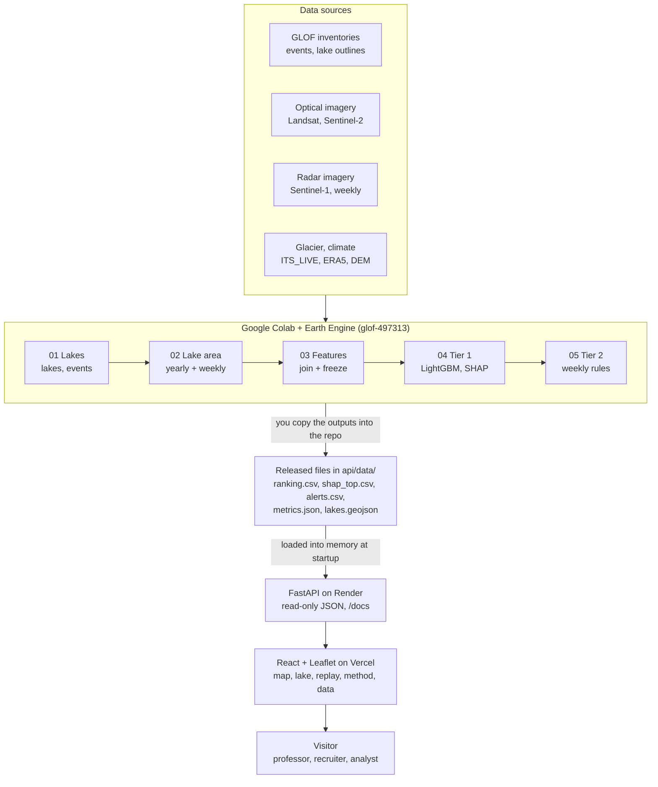

# KaraGLOF — Technical Specification

**Version:** 1.0 · **Date:** 2026-10-19 · **Companion:** [PRD.md](PRD.md) (product requirements)

---

## 1. System architecture

All satellite processing and modelling happens once in Colab. The deployed app reads only small released files, so hosting is free and fast.



Read it top down: four free data sources feed five notebooks in order, you copy their outputs into the repository, and the API serves them to the React app.

---

## 2. Data sources

All sources are free, and all except the event inventories are read inside Google Earth Engine, so nothing large is downloaded. The resolutions and years below are approximate, from memory; each is confirmed when its notebook loads it.

| Source | What it gives | Resolution | Years | Used for |
| --- | --- | --- | --- | --- |
| GLOF inventories: Bhambri et al. (Karakoram ice dams), Veh et al. (High Mountain Asia), global GLOF database (Lützow et al. 2023), ICIMOD | Event dates and lakes | Event list | 1900s–2023+ | Labels |
| News and reports (2023–2025) | Recent events missing from the inventories | Event list | 2023–2025 | Labels, marked "news" |
| Lake inventory (Zheng et al. 2021, ICIMOD) | Lake outlines | Polygons | ~2015–2018 | Lake list |
| Randolph Glacier Inventory v7 | Glacier outlines | Polygons | ~2000 | Parent glacier |
| Landsat 5/7/8/9 Collection 2 | Water index (NDWI) | 30 m | 2000–2025 | Yearly lake area |
| Sentinel-2 | Water index (NDWI) | 10 m | 2017–2025 | Yearly lake area (sharper) |
| Sentinel-1 GRD | Radar backscatter (sees through cloud) | 10 m, ~6–12 days | 2015–2025 | Weekly lake area |
| ITS_LIVE | Glacier surface velocity | 120 m | 2000–2022+ | Surge detection |
| Hugonnet et al. 2021 | Glacier elevation change | 100 m | 2000–2019 | Glacier thinning |
| ERA5-Land | Air temperature, rainfall, snowmelt | ~9 km, hourly | 2000–2025 | Degree-days, heat anomalies |
| MODIS MOD10A1 / MOD11A1 (the AppEEARS zip) | Snow cover, land surface temperature | 500 m / 1 km, daily | 2000–2025 | Snowmelt timing, heat check |
| Copernicus GLO-30 DEM | Elevation | 30 m | Static | Slope, elevation, dam geometry |
| WorldPop, OpenStreetMap | Population, roads, bridges | 100 m / vector | Recent | Exposure layer on the map (should) |

---

## 3. Data specification (table schemas)

### `lakes.csv` — one row per lake

| Column | Type | Meaning |
| --- | --- | --- |
| lake_id | string | Stable ID, e.g. `KG-HUN-001` |
| name | string | Local name, or empty |
| basin | string | `hunza`, `shimshal` or `shigar` |
| lat, lon | float | Centroid, WGS84 |
| area_ref_km2 | float | Area in the inventory year |
| dam_type | string | `ice`, `moraine`, `bedrock` or `unknown` |
| glacier_id | string | RGI v7 ID of the parent glacier |
| tier2 | bool | True for Shisper, Khurdopin, Passu |

### `events.csv` — one row per GLOF event

| Column | Type | Meaning |
| --- | --- | --- |
| event_id | string | e.g. `EV-2022-SHI` |
| lake_id | string | Links to lakes.csv |
| date | date | Drainage date (the first day if a range) |
| date_certainty | string | `day`, `month` or `year` |
| source | string | Inventory name or news URL |
| notes | string | Free text |

### `lake_year.parquet` — one row per lake per year (Tier 1 model table)

| Column group | Examples | Rule |
| --- | --- | --- |
| Keys | lake_id, year | |
| Label | glof (0/1) | 1 if an event happened at that lake in that year |
| Lake | area_km2_prev, area_growth_3y, area_growth_rate | Uses years before `year` only |
| Glacier | velocity_prev, velocity_change, surge_flag_prev, dh_dt | Uses years before `year` only |
| Climate | pdd_prev_summer, heat_anomaly_prev, rain_prev_summer, snowmelt_onset | Uses years before `year` only |
| Terrain | elev_m, slope_dam_deg, dist_to_glacier_m | Static |

### `lake_week.parquet` — one row per Tier 2 lake per week

| Column | Meaning |
| --- | --- |
| lake_id, week_start | Keys |
| area_km2_s1 | Sentinel-1 lake area, with gaps filled from optical images when available |
| area_change_2w_pct | Percentage change over the previous 2 weeks |
| t2m_anomaly_c | ERA5-Land 7-day mean temperature minus the 2000–2019 mean for that week |
| pdd_7d | Positive degree-days over the last 7 days |
| rain_7d_mm | Rainfall over the last 7 days |
| event_in_window | 1 if drainage happens within the next 14 days (for evaluation only, never a feature) |

### Outputs served by the API

| File | Columns / content |
| --- | --- |
| `ranking.csv` | lake_id, year, risk_score, rank |
| `shap_top.csv` | lake_id, year, feature, value, shap, text |
| `alerts.csv` | lake_id, week_start, level, reasons |
| `metrics.json` | All model results, CIs, ablation, data_version, model_version |
| `lakes.geojson` | Lake points/polygons with lake_id, name, basin |

---

## 4. Pipeline and notebook specs

Five Colab notebooks run in order. Each one reads the previous notebook's files from Google Drive (`Drive/KaraGlof/`) and must pass its checks before the next starts. All of them use Earth Engine project `glof-497313`.

### 01_lakes_and_labels
- **Inputs:** HydroBASINS, lake inventory, RGI v7, GLOF inventories (downloaded CSVs).
- **Steps:**
  1. Draw the three basins.
  2. Clip the lakes to the basins and drop lakes under 0.01 km².
  3. Link each lake to its nearest parent glacier.
  4. Match each event to a lake by name and distance.
- **Outputs:** `lakes.csv`, `events.csv`, a map of basins and lakes.
- **Checks:** every event has a lake_id and date certainty, or is listed as unmatched. Shisper, Khurdopin and Passu exist with `tier2 = true`.

### 02_lake_area
- **Inputs:** `lakes.csv`.
- **Steps:**
  1. Buffer each lake outline.
  2. Mask clouds in the Landsat/Sentinel-2 images from July to September.
  3. Make an NDWI water mask and take the largest water area each year.
  4. For the Tier 2 lakes, threshold the Sentinel-1 backscatter every week.
- **Outputs:** `lake_area_yearly.csv`, `lake_area_weekly.csv`, a Shisper area plot.
- **Checks:** the Shisper area rises before the 2019, 2020 and 2022 events and drops after them. No year with zero valid images is silently filled.

### 03_features
- **Inputs:** the files above, ITS_LIVE, Hugonnet, ERA5-Land, the MODIS zip, GLO-30 DEM.
- **Steps:**
  1. Compute glacier velocity per year and the surge flag.
  2. Summarise climate per summer and per week.
  3. Compute terrain statistics.
  4. Join everything, with a one-year lag for Tier 1.
- **Outputs:** `lake_year.parquet`, `lake_week.parquet`, a data dictionary.
- **Checks:** a leakage test asserts that no feature uses data from on or after the prediction date. The share of missing values per column is printed.
- **Gate: dataset frozen.** No new features after this notebook.

### 04_tier1_model
- **Inputs:** `lake_year.parquet`.
- **Steps:** baseline → Random Forest → LightGBM → metrics with bootstrap CIs → calibration → SHAP → ablation.
- **Outputs:** `ranking.csv`, `shap_top.csv`, `metrics.json`, figures, the saved model.

### 05_tier2_cases
- **Inputs:** `lake_week.parquet`, `events.csv`.
- **Steps:** apply the weekly rules → compute the alert level for each week → measure lead time and false alarms.
- **Outputs:** `alerts.csv`, one replay figure per event.

The outputs are copied into `api/data/` in the repository. That folder is the only data the web app reads.

---

## 5. Model specification

Tier 1 is a yearly LightGBM ranking, judged only on future years it hasn't seen. Tier 2 is a transparent rule set, judged on lead time before real outbursts.

### Tier 1 — yearly susceptibility

- **Unit:** one lake in one year. **Label:** `glof = 1` if that lake drained in that year.
- **Prediction time:** 1 January of the year. Every feature uses only data up to 31 December of the previous year.
- **Split by time, never shuffled:**

| Set | Years | Use |
| --- | --- | --- |
| Train | 2000–2017 | Fit models |
| Validation | 2018–2019 | Tune hyperparameters and early stopping |
| Test | 2020–2025 | Report final results once |

- **Models, in order:** logistic regression (baseline) → Random Forest → LightGBM. Class imbalance is handled with class weights (`scale_pos_weight`), never SMOTE.
- **Metrics:**
  - PR-AUC (the main metric), recall at top-10 per year, Brier score and a reliability plot.
  - 95% confidence intervals by bootstrap over lakes (1,000 resamples).
  - Accuracy is never reported.
- **Explanation:** SHAP TreeExplainer gives a global importance plot plus the top 5 drivers per lake-year, turned into plain sentences for the web app.
- **Ablation:** retrain LightGBM without the glacier group (velocity, surge flag, thinning) and compare PR-AUC with CIs. This answers the research question.
- **Fallback if there are too few events:** report the test set event by event (the rank of each event lake in its year). Use leave-one-year-out validation as a robustness check.

### Tier 2 — weekly warning signs

Tier 2 uses rules, not a trained model, because each lake has only a handful of events. Starting thresholds are set on pre-2022 data, then frozen before the 2022 replay.

| Level | Rule (computed only from data up to that week) |
| --- | --- |
| Green | None of the conditions below |
| Amber | Lake area grew more than 15% in 2 weeks, **or** area is above its 90th percentile for that lake **and** the 7-day temperature anomaly is above +2 °C |
| Red | Amber conditions hold for 2 weeks in a row, **or** area is above its 95th percentile with a heat anomaly above +3 °C |

The 15%, +2 °C and percentile values are starting points, not findings. They are tuned once on 2015–2021 and then frozen.

- **Lead time:** the days between the first amber (or red) week and the drainage date.
- **False alarms:** amber or red weeks not followed by drainage within 14 days, counted per lake per season.
- **Honesty rule:** thresholds are never changed after looking at the 2022 replay.

---

## 6. API specification

The API is a read-only FastAPI service under `/api/v1`. It loads the precomputed files into memory at startup and has no database and no write endpoints.

| Method | Path | Query parameters | Returns |
| --- | --- | --- | --- |
| GET | `/api/v1/health` | — | `{status, data_version, model_version}` |
| GET | `/api/v1/lakes` | `basin`, `tier2` | List of lakes (the fields of lakes.csv) |
| GET | `/api/v1/lakes.geojson` | `year` | FeatureCollection; each feature has lake_id, name, basin, risk_score, rank for that year |
| GET | `/api/v1/lakes/{lake_id}` | — | Lake fields + `area_history[]` + `risk_history[]` + `events[]` |
| GET | `/api/v1/lakes/{lake_id}/explain` | `year` | Top 5 drivers: `{feature, value, shap, text}` |
| GET | `/api/v1/rankings` | `year` (required), `limit` (default 10), `basin` | Ranked list `{rank, lake_id, name, risk_score}` |
| GET | `/api/v1/alerts/{lake_id}` | `from`, `to` (dates) | Weekly rows `{week_start, area_km2, t2m_anomaly_c, level, reasons[]}` |
| GET | `/api/v1/cases` | — | Case studies `{case_id, lake_id, event_date, lead_time_days}` |
| GET | `/api/v1/metrics` | — | Contents of metrics.json (test metrics, CIs, ablation) |
| GET | `/api/v1/downloads/{name}` | — | CSV file (lakes, events, lake_year, ranking) |

**Example:** `GET /api/v1/rankings?year=2024&limit=3`

```json
{
  "year": 2024,
  "data_version": "data-v1",
  "items": [
    {"rank": 1, "lake_id": "KG-HUN-012", "name": "Shisper", "risk_score": 0.41},
    {"rank": 2, "lake_id": "KG-SHM-003", "name": "Khurdopin", "risk_score": 0.33},
    {"rank": 3, "lake_id": "KG-HUN-027", "name": null, "risk_score": 0.18}
  ]
}
```

The values above are placeholders that show the shape only.

**Rules**
- Responses are validated with Pydantic models, and field names match the data tables.
- Errors: `404` with `{"detail": "lake not found"}` for an unknown lake; `422` for a bad parameter (the FastAPI default).
- CORS allows the frontend origin only.
- OpenAPI docs are public at `/docs`, which doubles as API documentation for reviewers.
- Every response carries `data_version` so the frontend can show which data release it is displaying.

---

## 7. Frontend specification

The frontend is a React single-page app with five pages, built around the map. A visitor should be able to reach the Shisper replay in two clicks from the home page.

| Route | Page | Main components | API calls |
| --- | --- | --- | --- |
| `/` | Map (home) | LakeMap, YearSelector, BasinFilter, TopTenPanel, Legend | lakes.geojson, rankings |
| `/lake/:id` | Lake detail | LakeHeader, AreaChart, RiskChart, DriverList, EventList | lakes/{id}, explain |
| `/case/:caseId` | Case replay | WeekSlider, AreaTempChart, AlertStrip, LeadTimeCard | cases, alerts/{id} |
| `/method` | Method | MetricsTable, AblationCard, SplitDiagram, Limitations | metrics |
| `/data` | Data | DownloadList, DataDictionary, DOI badge | downloads |

**Map behaviour**
- Leaflet with an OpenStreetMap or Esri satellite base layer; the view opens on the three basins.
- Lakes are circles sized by area and coloured on a sequential scale by risk score for the selected year.
- Hovering shows the name, rank and score; clicking opens the lake page. Tier 2 lakes carry a ring in their current alert colour.
- Selecting a lake in the Top-10 panel flies the map to it.

**Shared elements**
- A header with the project name, page links and a GitHub link.
- A disclaimer banner: "Research prototype — not an official warning. Data release vX."
- Loading skeletons, an empty state ("no data for this year") and an error state with a retry button.

**Design notes**
- A calm, scientific look: neutral background, one accent colour, risk colours from a colour-blind-safe scale.
- Alert colours (green, amber, red) are used only for Tier 2 levels, never for decoration.
- Charts use Recharts, and numbers always carry units (km², °C, days).
- Works at phone width; the map stacks above the panel.

---

## 8. Tech stack, repository and deployment

Python handles the data, models and API; TypeScript + React handle the frontend. Everything is hosted on free tiers.

| Layer | Choice | Why |
| --- | --- | --- |
| Data extraction | Google Earth Engine Python API (`earthengine-api`, `geemap`) in Colab | Petabytes of imagery without downloads |
| Data handling | pandas, geopandas, pyarrow (Parquet) | Standard, fast, typed columns |
| Models | scikit-learn, LightGBM, SHAP | Best fit for small tabular data; explainable |
| API | FastAPI, Pydantic, Uvicorn | Typed, fast, automatic OpenAPI docs |
| Frontend | React + TypeScript + Vite, React Router, Leaflet (react-leaflet), Recharts, TanStack Query | A real web stack that recruiters recognise |
| Styling | Tailwind CSS | Quick and consistent |
| Tests | pytest (API, data checks), Vitest (frontend) | One test runner per language |
| Quality | ruff (Python lint), ESLint + Prettier, GitHub Actions CI | Signals a clean repo |
| Packaging | Docker for the API | The same build locally and in hosting |
| Hosting | API on Render (free web service); frontend on Vercel | Both free; the Render free tier sleeps and takes about 1 minute to wake |

### Repository layout

```
KaraGlof/
├── notebooks/            01–05 Colab notebooks (.ipynb)
├── src/karaglof/         shared Python code used by notebooks (features, rules, metrics)
├── data/                 raw/ interim/ processed/  (git-ignored except small CSVs)
├── api/
│   ├── app/              main.py, routers/, schemas.py, store.py
│   ├── data/             released output files the API serves
│   ├── tests/
│   └── Dockerfile
├── web/                  React app (src/pages, src/components, src/api)
├── reports/figures/      plots for the write-up and slides
├── docs/                 PRD.md, SPECS.md, write-up, data dictionary
├── .github/workflows/    ci.yml
├── README.md
└── LICENSE               MIT for code; CC BY 4.0 for data
```

### Environments
- **Colab:** notebooks 01–05; Earth Engine project `glof-497313`; files saved to `Drive/KaraGlof/`.
- **Local (VS Code):** a Python 3.11+ virtual environment for the API; Node 20+ for the web app.
- **Production:** Render (API Docker image) and Vercel (static web build), with the API URL set as an environment variable.

### Version control
Claude writes files in `J:\KaraGlof` but never commits or pushes. The owner reviews, commits and pushes each milestone to [github.com/inamjadoon/KaraGlof](https://github.com/inamjadoon/KaraGlof).

---

## 9. Testing and acceptance criteria

The project is accepted when every item below is checked. The data checks matter more than the UI tests, because a wrong dataset makes everything after it wrong.

### Data and model checks
- [ ] Every event in `events.csv` has a lake_id, date and date certainty, or sits in an "unmatched" list with a reason
- [ ] The Shisper yearly area plot shows growth before the 2019, 2020 and 2022 events
- [ ] No year of lake area is filled without being flagged as filled
- [ ] The leakage test passes: no Tier 1 feature uses data from the prediction year or later
- [ ] Train, validation and test years don't overlap; the test set was scored once
- [ ] LightGBM PR-AUC and Brier score reported against the baseline with 95% CIs
- [ ] Ablation table reported, whatever the result
- [ ] Tier 2 thresholds frozen before the 2022 replay; lead time and false alarms reported

### API checks (pytest)
- [ ] Every endpoint returns 200 with a valid schema on sample data
- [ ] An unknown lake returns 404; a bad year returns 422
- [ ] `lakes.geojson` is valid GeoJSON with one feature per lake

### Web app checks
- [ ] The map loads, the year selector changes the colours, and clicking a lake opens its page
- [ ] The Shisper replay shows the week slider, alert strip and lead time
- [ ] The disclaimer banner is visible on every page; the layout works at 375 px width
- [ ] Lighthouse performance and accessibility scores are 80 or higher

### Delivery checks
- [ ] The live web link and the API `/docs` link both work
- [ ] The README explains the project in 5 minutes, with a screenshot and instructions for running it
- [ ] The Zenodo dataset is published with a DOI
- [ ] A short write-up (4–6 pages) and a 10-slide deck are ready
